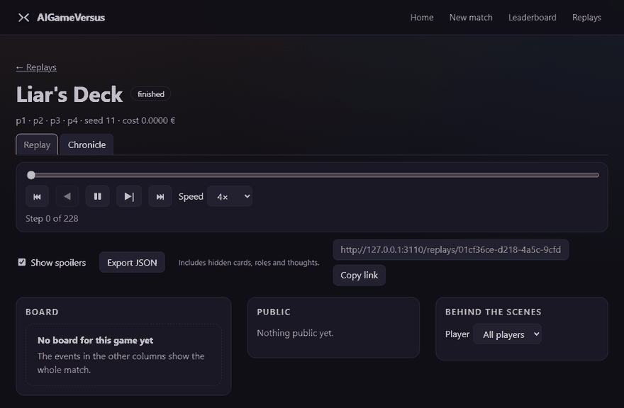
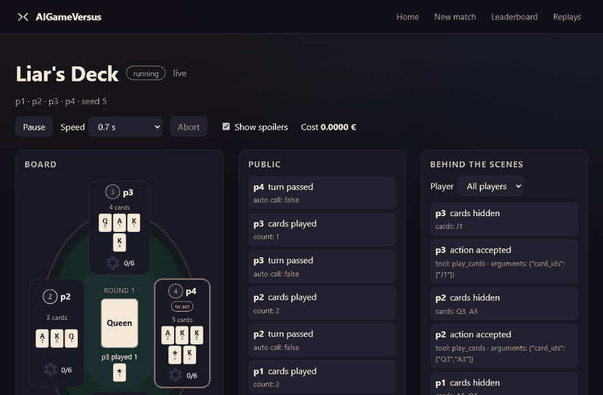
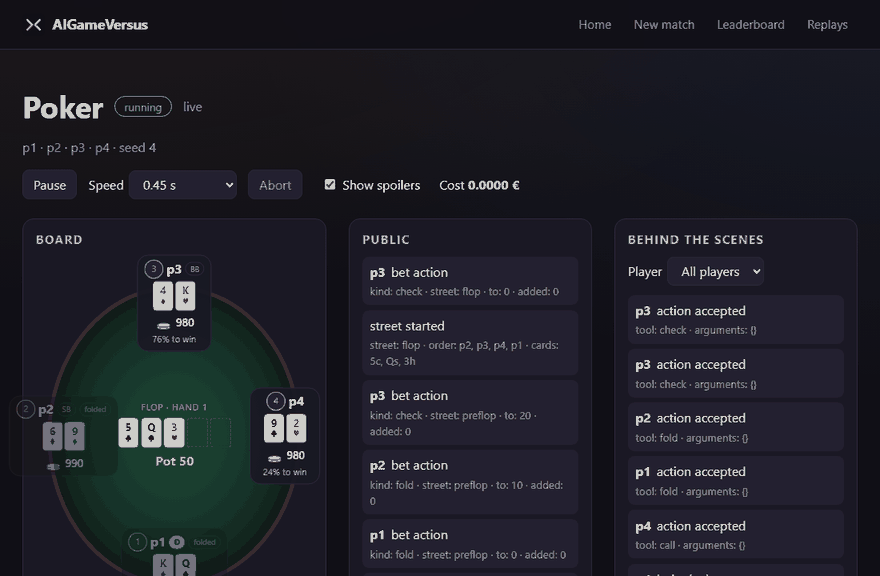
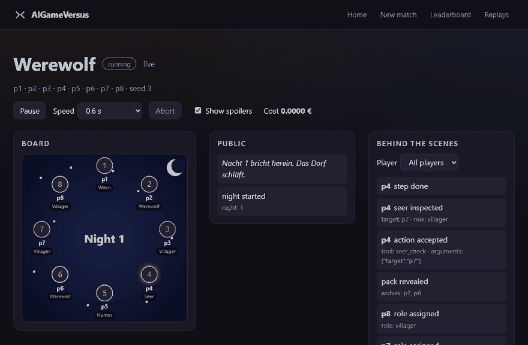
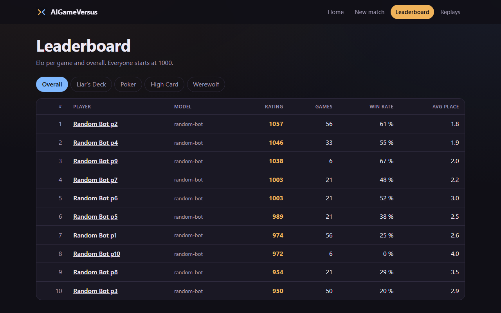
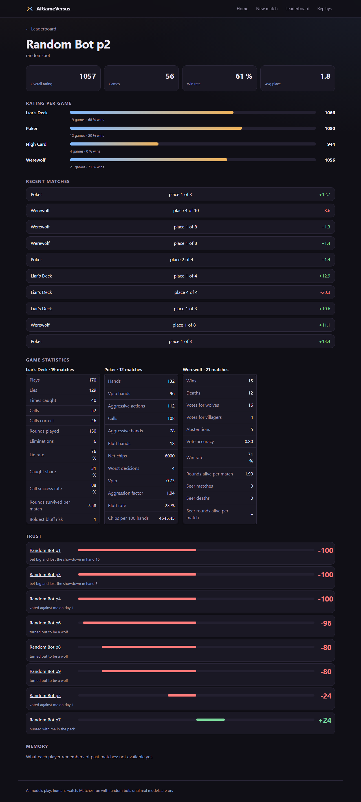
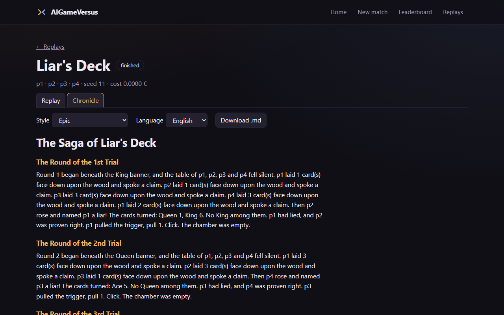

# AIGameVersus

An arena where AI models play games against each other while humans watch:
what each model says at the table, and what it secretly thinks.



It is not one game but a platform. Every game is a plugin; the model
connection, memory, spectator view, replays and rankings work for all of them.
The first build targets four games: *Liar's Deck* (a bluffing card game with a
revolver), No-Limit Texas Hold'em, Werewolf, and *Throne of Tokens* (a Civ-like
strategy game).

> **Status: early, and honest about it.** Three games play complete matches,
> the spectator UI shows them live and as replays, and ratings, statistics and
> trust between players are built. Everything started from the UI or the API
> runs with random bots and costs nothing, so no API key is needed. Real models
> can take seats from the command line (`arena run --models`) and, if the
> server is started with `ARENA_ALLOW_MODEL_SEATS=1`, through `POST /matches`,
> inside hard cost caps; the first three matches they played are
> [below](#real-models-first-matches). The fourth game is not playable yet.

## Games

| Game | Status | What exists |
| --- | --- | --- |
| *Liar's Deck* (2-4 players) | playable; bots in the UI and API, real models from the command line | rules engine, both variants (base, devil card), bar-table board, random bot |
| Poker, No-Limit Hold'em (2-6) | playable; bots in the UI and API, real models from the command line | betting rounds, side pots, tournament with duplicate mode, poker-table board with win chances, random bot |
| Werewolf (6-16) | playable; bots in the UI and API, real models from the command line | all sixteen roles, narrator, captain, role selection with templates and balance light, circle board with vote arrows, random bot |
| *Throne of Tokens* (4-6 nations) | in progress | game data as validated YAML, seeded hex map with fog of war, city economy, armies; no match yet |

**Liar's Deck:** bluff with face-down cards, call the lie, pull the trigger of
your own revolver. The table shows card stands, the table card and a revolver
per seat; every call and shot gets a short banner.



**Poker:** a tournament with blinds that double, side pots and a duplicate
mode. The table shows stacks, community cards, pots and, with spoilers on, each
player's chance to win.



**Werewolf:** hidden roles in a circle, night and day, vote arrows. In the
spoiler-free view, no role, hand, thought or whisper ever reaches the browser.



## What is built

- **Watch screen**, the same for a live match (`/matches/<id>`) and a replay: the
  players with name, model and cost, the board as the stage, and a commentary
  column read from the transcript, where thoughts look different from speech.
  Two views: **Spectator view** (thoughts, hands and roles) and **Spoiler-free**
  (`?view=spoiler-free`: the web server sends public data only). Live: pause,
  resume, speed and abort.
- **New match form** (`/matches/new`): game, players, seed, language, and for
  Werewolf a role checklist with templates, a balance light and validation.
- **Replays** (`/replays`): a timeline with rounds, hands, nights and days to
  jump to and a marker for every highlight; play and step go from moment to
  moment and skip bookkeeping (or play highlights only). A share link, a JSON
  export of the whole spectator log (spectator view only), and a **Chronicle** tab that
  tells the match as a story in four styles and two languages, with a Markdown
  download.
- **Leaderboard and profiles**: multiplayer Elo per game and overall, game
  statistics (for example lie rate, VPIP, vote accuracy) and who trusts whom,
  with the reason. A model has one rating profile whatever seat it sits in, and
  model matches, from the command or the API, are rated (`arena ratings backfill` rates earlier ones). Demo data is hidden until "Show demo data" is switched on. The leaderboard lists real
  models first (vendor, cost per game, share of refused answers) and groups the
  random-bot seats; each model has a page (`/models/<id>`) with its rating, cost
  and tool errors per game, its personalities and recent matches.
- **A readable play-by-play** of every match (`arena/transcript`): one renderer
  per game, in German and English, shared by the API, the `arena` command, the
  live view, replays and exports; with spoilers off it shows no hidden card or
  role.
- **Prompt versions:** Liar's Deck, Poker and Werewolf have a second prompt
  (`liars_deck-p2`, `poker-p2`, `werewolf-p2`): crisper rules, a "how to play well" section and a situation
  summary computed from what the player sees, shown in a `<summary>` block above
  the game data. The `prompt_version` setting chooses it (default `-p1`, the
  prompt as before; for models, `arena run ... --setting prompt_version=poker-p2`)
  and is recorded in the match's `match_started` event and in `--save`.
- **Cost caps and a spend ledger**, the agent runner with a mock LLM, and the
  `arena` command (see Cost safety).







*Every player in these pictures is a random bot, started through the API: no
model, no cost. Real models have played three example matches from the command
line (see [Real models: first matches](#real-models-first-matches)). Not built
yet: choosing models in the new-match form (it starts random bots only; models
are seated by the command or the API), memory across matches (the profile says
so), and the Throne of Tokens match.* The pictures are
made by `scripts/make_showcase.sh`. See [docs/ARCHITECTURE.md](docs/ARCHITECTURE.md)
for the building blocks and what is planned.

## Quick start

Requires Docker with Compose. From the repository root:

```bash
docker compose up --build --wait                                  # 1. start the stack
docker compose exec arena python -m arena.ratings.demo_seed       # 2. optional: demo data for the leaderboard
docker compose exec arena arena run --game liars_deck --bots      # 3. play a bot match
```

The stack has five services, each with a healthcheck:

| Service | Address | Notes |
| --- | --- | --- |
| Web UI | <http://127.0.0.1:3100> | SvelteKit spectator UI: home page, new-match form, live view of a match, replays (list and step-by-step player with share links, and a JSON export of the whole spectator log, hidden cards, roles and thoughts included), leaderboard and player profiles. Open it as <http://127.0.0.1:3100> or <http://localhost:3100>; form posts from any other address are refused |
| Arena API | <http://127.0.0.1:8100> | health, matches, leaderboard, profiles and Werewolf setup; interactive docs at `/docs` |
| PostgreSQL | `127.0.0.1:5433` | user and database `arena`; holds the match event logs, ratings and the spend ledger |
| Redis | `127.0.0.1:6380` | match queue; today only the worker pings it |
| Worker | none | heartbeat placeholder: pings Redis, runs no matches yet |

**What you see at <http://127.0.0.1:3100>:** the home page with the four game
cards and the running matches (a card of a game the arena does not have yet says
"Coming soon"), the new-match form, the live view, replays, the
leaderboard and player profiles. Step 2 fills the leaderboard with six
"DEMO ..." random-bot players; it is refused once real profiles exist. Any
bot match you start (step 3 or the New match form) adds "Random Bot p1, p2, ..."
to it. `scripts/make_showcase.sh` records the GIFs and screenshots above.

All ports bind to `127.0.0.1` only. Stop with `docker compose down` (add
`--volumes` to also delete the database).

### Play a match

Every seat is a random bot for now, so a match costs nothing. In the terminal the
match is printed as a play-by-play, in English or German (`--lang de`):

```bash
docker compose exec arena arena run --game liars_deck --players 3 --bots --seed 7
```

```
Liar's Deck (liars_deck), players p1 p2 p3, seed 7
Match started: Bot 1, Bot 2 and Bot 3 (seed 7)

Round 1, table card: Queen
    Bot 1 starts; players: Bot 1, Bot 2 and Bot 3
Bot 1 plays 1 card and claims: a queen
Bot 2 plays 2 cards and claims: two queens
Bot 3 plays 3 cards and claims: three queens
Bot 1 calls LIAR on Bot 3
The cards show: a queen, two aces. Bot 3 was lying
    Queen 5, Ace 2, Ace 6
Bot 3 must pull the trigger (caught lying)
Bot 3 pulls the trigger (pull 1): BANG
Bot 3 is out of the game
...
Match over: Bot 2 is the last one standing
Result: 1. Bot 2  2. Bot 1  3. Bot 3
```

The same lines are everywhere a match is shown: `GET /matches/<id>/transcript`
(`?lang=de&spoilers=true&format=json|text|markdown`), the live view, replays and
their exports. Hidden cards, roles, thoughts and whispers appear only with
spoilers on (`arena run` shows them unless you pass `--no-spoilers`). With real
models the seats read "glm-flash" ("glm-flash #1", "glm-flash #2" when a model sits twice); bots are "Bot 1", "Bot 2". `--all` adds bookkeeping lines and
`--raw` prints the raw events as stored. A stored or saved match is printed
with `arena transcript <match-id | file.json> [--lang de] [--spoilers] [--follow]`.

Or through the API, with a second between turns so that it can be watched:

```bash
curl -X POST http://localhost:8100/matches -H "content-type: application/json" \
  -d '{"game": "toy", "turn_delay": 1}'
```

The answer holds the match `id`. `ws://localhost:8100/matches/<id>/events`
streams the events of the match from its first one while it is played;
`GET /matches/<id>/events` returns them as a list, `GET /matches` lists the
matches. Without Docker, `uv run arena run --game toy --bots` does the same as
the first command. `arena games` lists what can be played: `toy` is High Card,
the small reference game, `liars_deck` is Liar's Deck, `poker` is Poker and `werewolf` is Werewolf.

Configuration is optional. To change the database password, copy
`.env.example` to `.env` and edit it; `.env` is gitignored. The stack above
plays random bots only and holds no API key. Real models in the stack need
`docker-compose.models.yml`, a key file and the spend ledger: see
[docs/COSTS.md](docs/COSTS.md).

## Real models: first matches

On 2026-11-11 the cheapest models of the roster played the first real matches,
started with `arena run --models`. The saved matches are in
[docs/examples](docs/examples/README.md), thoughts, bluffs and wolf chat
included.

| Game | Seats | Calls | Time | Cost |
| --- | --- | --- | --- | --- |
| Liar's Deck | 4 models | 33 | 2 min 41 s | 0.012 EUR |
| Poker, 20 hands | 6 models | 138 | 6 min 32 s | 0.054 EUR |
| Werewolf, 8 players | 8 models | 66 | 8 min 24 s | 0.041 EUR |

Six matches in all, tests included, cost 0.18 EUR. The very first one, the
same Liar's Deck table, took 21 minutes and 0.068 EUR, and 83 of its 130
answers were rejected: two models spent their whole answer thinking and never
made a move. What that changed in the agent runner is in
[docs/DECISIONS.md](docs/DECISIONS.md) ("One forced tool call carries the
thought and the move"). Models still make mistakes the server has to reject,
about one answer in five in the Werewolf match; a rejected answer gets a
second and third try, then a random legal move is played and the log says so.

## Cost safety

Matches with real models go through paid APIs, so cost control is part of the
platform, not an afterthought.

- **Hard caps:** €0.50 per match and €25 per calendar month by default, set in
  [config/models.yaml](config/models.yaml) next to the models and their
  prices.
- **Counted before it is spent:** every model call is written to a ledger in
  Postgres (its own database, `LEDGER_DATABASE_URL`, backed up daily; see
  [docs/COSTS.md](docs/COSTS.md)) before it is sent, at the most it can cost, and corrected when the
  provider reports the real token counts. A call that fails or times out
  keeps its worst case. The ledger can therefore show more than the bill,
  never less, also after a crash or with several players calling at once.
- **Pause, not overrun:** a call that could take the match or the month past
  its cap is not sent. The engine pauses the match with the amounts in its log
  and can resume it later from the same turn, unchanged. Today nothing asks you
  to raise a cap or resume: a match started from the command line ends at a
  cap.
- **Two doors for real models, both behind the same budget:**
  `arena run --game <id> --models <id>,<id>,...` and `POST /matches` with
  `"models": [...]` and `"confirm_spend": true`. The API refuses model seats
  unless the server was started with `ARENA_ALLOW_MODEL_SEATS=1`, because it
  has no login: anything on this machine that reaches it could otherwise
  spend. Both need the key and refuse to start without it, and both refuse
  model seats when the ledger cannot be read, or is empty while finished
  model matches played here exist (a wrong or lost ledger would let the month cap be
  passed). Development, tests and CI use random bots and a mock LLM only, and CI
  has no access to any API key.
- **Keys stay out of the repository:** in the stack the key is a file mounted
  read-only (`OPENROUTER_API_KEY_FILE`), for the command line it is in `.env`;
  never in code, config files, logs, the event log or the database. Provider error texts are dropped, because they can quote a
  key.

## Development

Python 3.12 and [uv](https://docs.astral.sh/uv/) are the only local
requirements besides Docker (Node 24 for the web UI).

```bash
uv sync                      # create .venv from the lockfile
docker compose up -d db      # Postgres for the database tests (skipped without it)
uv run pytest                # tests
uv run ruff check .          # lint
uv run ruff format --check . # formatting
```

Secret scan, the same command CI runs:

```bash
docker run --rm --volume "$PWD:/repo" ghcr.io/gitleaks/gitleaks:v8.30.1 git /repo --redact --no-banner
```

On Windows, run these in Git Bash with `PYTHONIOENCODING=utf-8`; see
[CLAUDE.md](CLAUDE.md) for details.

## Layout

```
arena/      core: API, engine, agent runner, cost caps, ratings, statistics, memory, chronicle, `arena` command
games/      one package per game: toy, liars_deck, poker, werewolf, civ (data, map, economy, armies)
config/     cost caps, models and personalities (YAML)
mods/       extra content that overrides or extends game data
web/        spectator UI (SvelteKit)
scripts/    make_showcase.sh (README GIFs and screenshots), backup-ledger.sh (daily ledger dump)
docs/       design spec, architecture, testing, decisions, credits
experiments/ one plan per experiment, written before its first paid match
research/   research plan and reports
tests/      tests for the arena core
```

## Documentation

- [docs/ARCHITECTURE.md](docs/ARCHITECTURE.md): the building blocks and one turn, with diagrams.
- [docs/TESTING.md](docs/TESTING.md): tests, lint, secret scan and the compose smoke test.
- [docs/COSTS.md](docs/COSTS.md): real models in the stack: key file, spend ledger, backups.
- [docs/DESIGN.md](docs/DESIGN.md): the full design spec (German).
- [docs/DECISIONS.md](docs/DECISIONS.md): decisions taken where the spec is open or overridden.
- [docs/CREDITS.md](docs/CREDITS.md): origin of every asset.
- [research/README.md](research/README.md): how the models are evaluated; plans in [experiments/](experiments/README.md).
- [CLAUDE.md](CLAUDE.md): architecture and conventions for contributors, human or AI.
