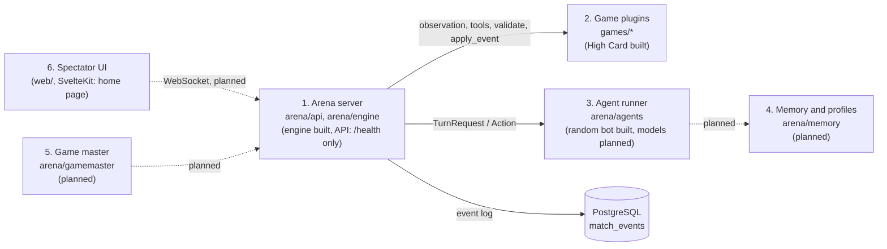
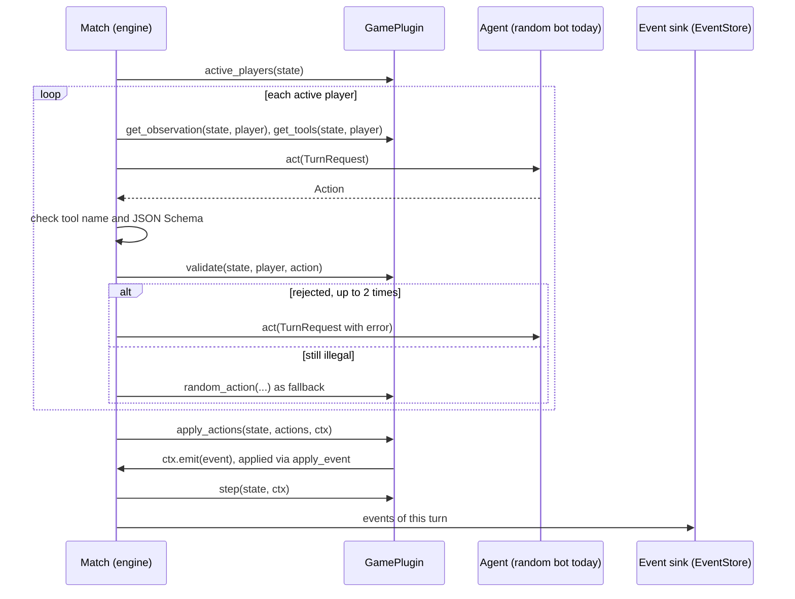

# Architecture

What is built on `main` today, and what is planned. Spec: [DESIGN.md](DESIGN.md)
(German). Decisions that override it: [DECISIONS.md](DECISIONS.md).

## The six building blocks

| Block | Where | State |
| --- | --- | --- |
| 1. Arena server | `arena/engine/` (turn loop, replay, seeded RNG), `arena/api/app.py` (FastAPI, `GET /health`, migrates the database at startup) | engine built; API for matches, WebSocket planned |
| 2. Game plugins | `games/<id>/`; `games/toy` is the reference game | one reference game; real games planned |
| 3. Agent runner | `arena/agents/random_bot.py` | random bot only; prompts, model calls, mock LLM planned |
| 4. Memory and profiles | `arena/memory/` | planned (empty package) |
| 5. Game master | `arena/gamemaster/` | planned (empty package) |
| 6. Spectator UI | `web/` (SvelteKit on Node; pages load API data server-side through `web/src/lib/api.ts`) | home page with game cards and running matches; New match, Leaderboard, Replays are placeholders |

## Engine

- `arena/engine/plugin.py`: `GamePlugin`, the interface every game implements, and
  `TurnContext` (`ctx.rng`, `ctx.emit`). The state changes only in
  `apply_event`.
- `arena/engine/match.py`: `Match` runs one match. It asks the active players
  for an `Action`, checks tool name, argument schema and `plugin.validate`,
  allows up to `MAX_CORRECTIONS = 2` retries, then plays the game's
  `random_action` as fallback. An optional `sink` receives the events of each
  turn.
- `arena/engine/types.py`: `Event`, `Action`, `ToolSpec`, `TurnRequest`,
  `Placement`, `TurnMode`, the `Agent` protocol.
- `arena/engine/replay.py`: `replay(plugin, events)` rebuilds the state from a
  log or any prefix; it needs no seed.
- `arena/engine/rng.py`: `derive_rng(seed, *key)`, independent seeded streams.

### One turn

A turn without a game event stops the match with a `PluginError`.

## Events, storage and replay

- A match is a list of `Event`s. Engine events (`match_started`,
  `action_accepted`, `action_rejected`, `action_fallback`, `match_finished`)
  are bookkeeping; game events come from the plugin and are the only thing
  that changes game state.
- Each event has `visible_to`: `None` public, a tuple of players, or an empty
  tuple for spectators only. The seed in `match_started` is spectators only.
- Event data must survive a JSON round trip; the engine enforces this at emit.
- `arena/db/event_store.py`: `EventStore.append(match_id, first_seq, events)` and
  `load(match_id)` on the `match_events` table.
- `arena/db/database.py`: `connect(url)` and `migrate(pool)`; numbered SQL files
  in `arena/db/migrations/` (today `0001_match_events.sql`), applied at API
  startup under an advisory lock.

## Processes and Compose services

Compose project `aigameversus`, host ports bound to `127.0.0.1`:

| Service | Host port | What it does today |
| --- | --- | --- |
| `arena` | 8100 | FastAPI app, `GET /health`, runs migrations at startup |
| `worker` | none | heartbeat placeholder: pings Redis; `python -m arena.worker --check` is its healthcheck. Does not run matches yet (planned) |
| `web` | 3100 | SvelteKit app (`node build`); calls the arena at `ARENA_API_URL=http://arena:8000` inside the Compose network |
| `db` | 5433 | PostgreSQL 18, user and database `arena` |
| `redis` | 6380 | planned match queue; only the worker pings it |

## Planned

Model calls and prompts (step 1.4), live streaming to the UI (1.6), game
registry, memory and Elo, game master, and all real games.
