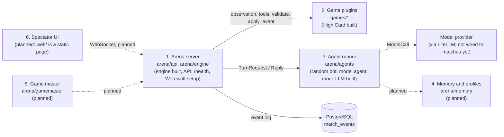
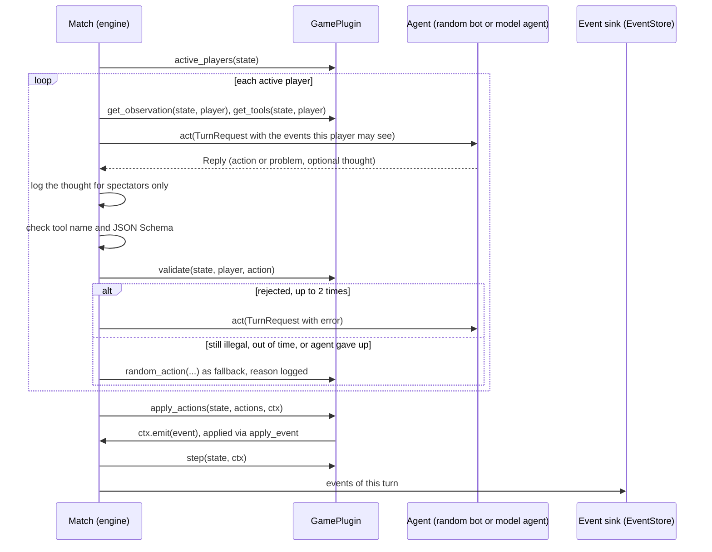
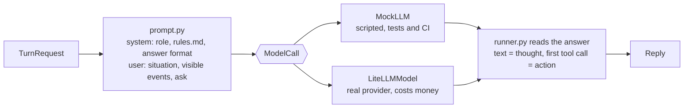

# Architecture

What is built on `main` today, and what is planned. Spec: [DESIGN.md](DESIGN.md)
(German). Decisions that override it: [DECISIONS.md](DECISIONS.md).

## The six building blocks

| Block | Where | State |
| --- | --- | --- |
| 1. Arena server | `arena/engine/` (turn loop, replay, seeded RNG), `arena/api/app.py` (FastAPI, `GET /health`, migrates the database at startup), `arena/api/werewolf.py` (role list and selection check for the new-match dialog) | engine built; API for matches, WebSocket planned |
| 2. Game plugins | `games/<id>/`; `games/toy` is the reference game | one reference game; real games planned |
| 3. Agent runner | `arena/agents/`: `random_bot.py`, `runner.py` (`ModelAgent`), `prompt.py`, `model.py` (the model-call boundary), `mock_llm.py`, `litellm_model.py` | built; real models are not wired to matches until the cost caps exist (step 1.5) |
| 4. Memory and profiles | `arena/memory/` | planned (empty package) |
| 5. Game master | `arena/gamemaster/` | planned (empty package) |
| 6. Spectator UI | `web/` | static placeholder page |

## Engine

- `arena/engine/plugin.py`: `GamePlugin`, the interface every game implements, and
  `TurnContext` (`ctx.rng`, `ctx.emit`). The state changes only in
  `apply_event`.
- `arena/engine/match.py`: `Match` runs one match. It asks the active players
  for a `Reply`, logs its thought for spectators only, checks the action (tool
  name, argument schema, `plugin.validate`) and allows up to
  `MAX_CORRECTIONS = 2` retries. Without a legal action in time
  (`turn_timeout`), or for a seat whose agent gave up, it plays the game's
  `random_action` and logs the reason. An optional `sink` receives the events
  of each turn.
- `arena/engine/types.py`: `Event`, `Action`, `ToolSpec`, `TurnRequest`,
  `Reply`, `Placement`, `TurnMode`, the `Agent` protocol, `AgentError`.
- `arena/engine/replay.py`: `replay(plugin, events)` rebuilds the state from a
  log or any prefix; it needs no seed.
- `arena/engine/rng.py`: `derive_rng(seed, *key)`, independent seeded streams.

### One turn

A turn without a game event stops the match with a `PluginError`.

## Agent runner

- `ModelAgent` (`arena/agents/runner.py`) retries a failed call 3 times (after
  1, 2 and 4 s), then raises `AgentError`; the engine takes the seat.
- A prompt holds only what the engine put into the request: events with
  `is_visible_to(player)`. Thoughts are never among them.
- Game data in a prompt is JSON, one event per line, `<` escaped. Words of
  another player are `message` events and appear as `player p2 says: "..."`.
- `MockLLM` stands in at the `ModelCall` boundary, so prompt building, answer
  parsing, retries and the engine run for real in tests.

## Events, storage and replay

- A match is a list of `Event`s. Engine events (`match_started`, `thought`,
  `action_accepted`, `action_rejected`, `action_fallback`, `agent_failed`,
  `match_finished`) are bookkeeping; game events come from the plugin and are
  the only thing that changes game state.
- Each event has `visible_to`: `None` public, a tuple of players, or an empty
  tuple for spectators only. The seed in `match_started`, thoughts and
  `agent_failed` are spectators only.
- Event data must survive a JSON round trip; the engine enforces this at emit.
- `arena/db/event_store.py`: `EventStore.append(match_id, first_seq, events)` and
  `load(match_id)` on the `match_events` table.
- `arena/db/database.py`: `connect(url)` and `migrate(pool)`; numbered SQL files
  in `arena/db/migrations/` (today `0001_match_events.sql`, `0002_ratings.sql`),
  applied at API startup under an advisory lock.
- `arena/ratings/`: multiplayer Elo (`elo.update_ratings`, `overall_rating`),
  count-based statistics (`stats`), and `RatingStore` on the `player_profiles`,
  `ratings` and `rated_matches` tables. `apply_match_result(match_id, game_id,
  placements)` counts each match once. Nothing calls it yet; match setup (1.6)
  and profiles with memory (phase 6) will.

## Processes and Compose services

Compose project `aigameversus`, host ports bound to `127.0.0.1`:

| Service | Host port | What it does today |
| --- | --- | --- |
| `arena` | 8100 | FastAPI app, `GET /health`, runs migrations at startup |
| `worker` | none | heartbeat placeholder: pings Redis; `python -m arena.worker --check` is its healthcheck. Does not run matches yet (planned) |
| `web` | 3100 | static placeholder page |
| `db` | 5433 | PostgreSQL 18, user and database `arena` |
| `redis` | 6380 | planned match queue; only the worker pings it |

## Planned

Model configuration and cost caps (step 1.5), CLI, match API and live
streaming to the UI (1.6), game registry, memory, rating matches automatically, game master, and all
real games.
