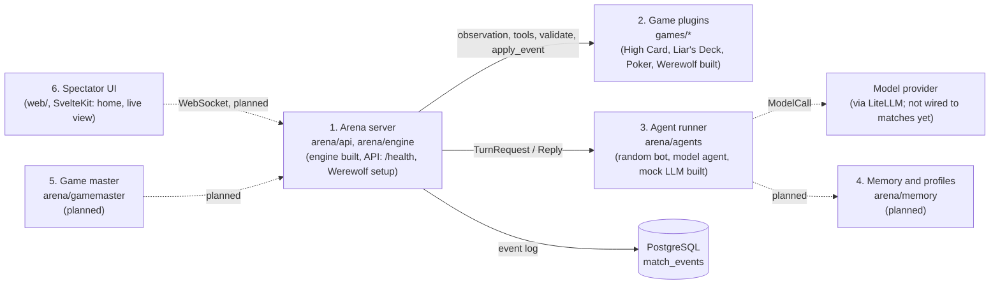
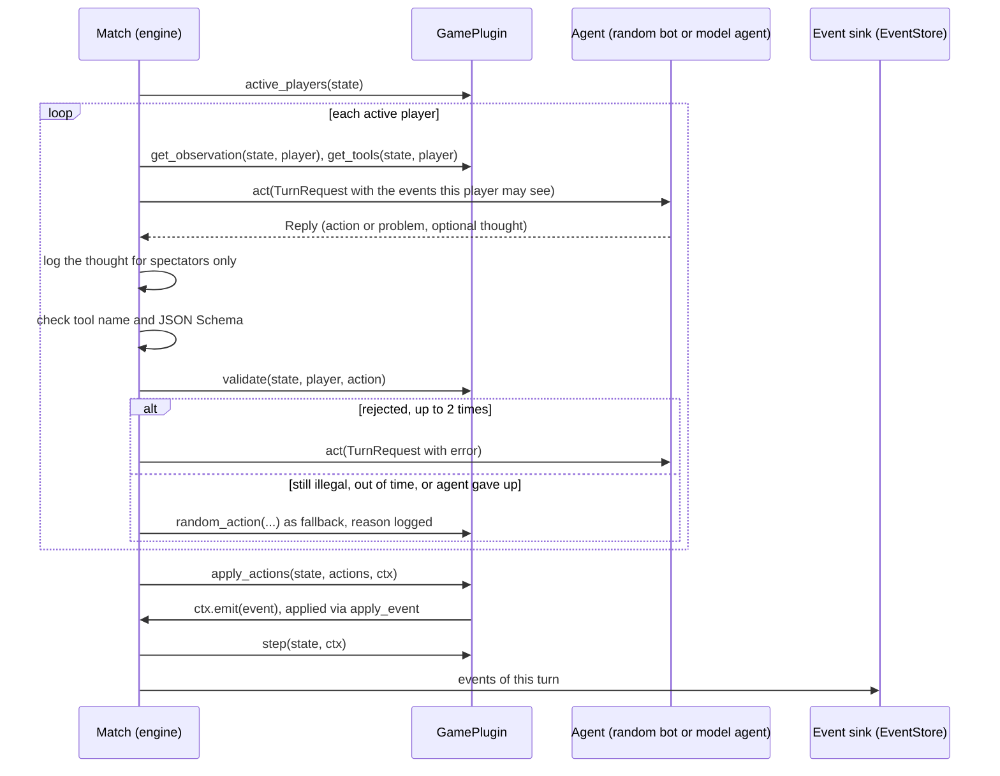
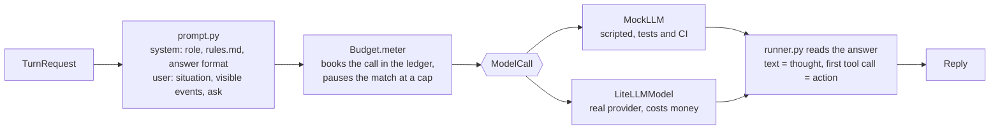
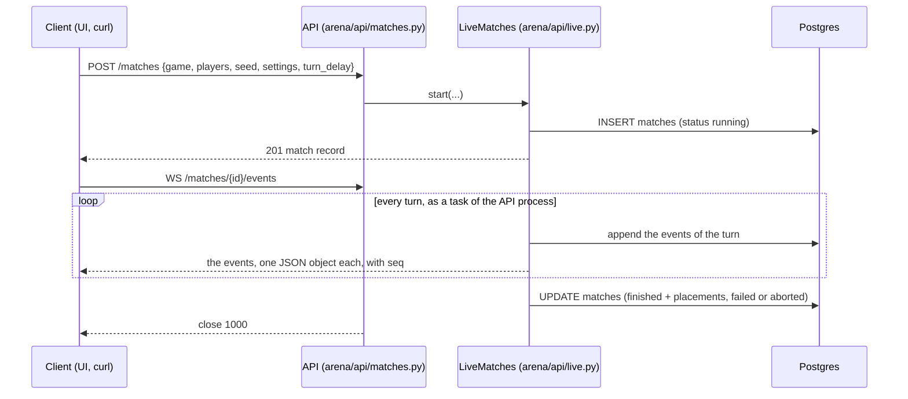

# Architecture

What is built on `main` today, and what is planned. Spec: [DESIGN.md](DESIGN.md)
(German). Decisions that override it: [DECISIONS.md](DECISIONS.md).

## The six building blocks

| Block | Where | State |
| --- | --- | --- |
| 1. Arena server | `arena/engine/` (turn loop, replay, seeded RNG), `arena/api/app.py` (FastAPI, `GET /health`, migrates the database at startup), `arena/api/werewolf.py` (role list and selection check for the new-match dialog), `arena/api/setup.py` (`GET /setup`: models, personalities, cost caps), `arena/api/matches.py` and `live.py` (start, list, stream and control matches, board and cost), `arena/games.py` (finds the games), `arena/cli.py` (the `arena` command) | built for matches of random bots; model seats planned |
| 2. Game plugins | `games/<id>/`; `games/toy` is the reference game | High Card, Liar's Deck (`games/liars_deck`, both variants), Poker (`games/poker`, tournament and duplicate mode) and Werewolf (`games/werewolf`, all 16 roles, captain, narrator) play full matches; Throne of Tokens has its data, map generation, fog of war and city economy (`games/civ`), no plugin yet |
| 3. Agent runner | `arena/agents/`: `random_bot.py`, `runner.py` (`ModelAgent`), `prompt.py`, `model.py` (the model-call boundary), `mock_llm.py`, `litellm_model.py` | built, with cost caps (`budget.py`); nothing starts a match with a real model yet (phase 2, when a key exists) |
| 4. Memory and profiles | `arena/memory/` | planned (empty package) |
| 5. Game master | `arena/gamemaster/` | planned (empty package) |
| 6. Spectator UI | `web/` (SvelteKit on Node; pages load API data server-side through `web/src/lib/api.ts`) | home page with game cards and running matches, new-match form, live view of a match, leaderboard with game tabs, player profiles; Replays is a placeholder |

## Engine

- `arena/engine/plugin.py`: `GamePlugin`, the interface every game implements, and
  `TurnContext` (`ctx.rng`, `ctx.emit`). The state changes only in
  `apply_event`.
- `arena/engine/match.py`: `Match` runs one match. It asks the active players
  for a `Reply`, logs its thought for spectators only, checks the action (tool
  name, argument schema, `plugin.validate`) and allows up to
  `MAX_CORRECTIONS = 2` retries. Without a legal action in time
  (`turn_timeout`), or for a seat whose agent gave up, it plays the game's
  `random_action` and logs the reason. An optional `sink` receives the events
  of each turn. When an agent raises `MatchPaused`, the turn is dropped,
  `match_paused` is logged and `run()` raises the pause; `run()` again
  continues with that turn.
- `arena/engine/types.py`: `Event`, `Action`, `ToolSpec`, `TurnRequest`,
  `Reply`, `Placement`, `TurnMode`, the `Agent` protocol, `AgentError`,
  `MatchPaused`.
- `arena/engine/replay.py`: `replay(plugin, events)` rebuilds the state from a
  log or any prefix; it needs no seed.
- `arena/engine/rng.py`: `derive_rng(seed, *key)`, independent seeded streams.

### One turn

A turn without a game event stops the match with a `PluginError`. So does a
match that is not over after `max_turns` turns (set per game on the plugin,
or per match): the log then ends with `turn_limit_reached`.

## Agent runner

- `ModelAgent` (`arena/agents/runner.py`) retries a failed call 3 times (after
  1, 2 and 4 s), then raises `AgentError`; the engine takes the seat.
- A prompt holds only what the engine put into the request: events with
  `is_visible_to(player)`. Thoughts are never among them.
- Game data in a prompt is JSON, one event per line, `<` escaped. Words of
  another player are `message` events and appear as `player p2 says: "..."`.
- `MockLLM` stands in at the `ModelCall` boundary, so prompt building, answer
  parsing, retries and the engine run for real in tests.
- `Budget` (`arena/agents/budget.py`) wraps the `ModelCall` of every seat of a
  match. It books each call in the `model_calls` table before it is sent, at
  its upper bound, and corrects the booking when the provider reports the
  tokens. A call that would pass the cap of the match or of the month is not
  sent: the budget raises `MatchPaused`. Limits and prices come from
  `config/models.yaml` (`arena/config.py`). `Budget.model` is the only place
  that builds a `LiteLLMModel`.

## Events, storage and replay

- A match is a list of `Event`s. Engine events (`match_started`, `thought`,
  `action_accepted`, `action_rejected`, `action_fallback`, `agent_failed`,
  `match_paused`, `match_resumed`, `turn_limit_reached`, `match_finished`) are
  bookkeeping; game
  events come from the plugin and are the only thing that changes game state.
- Each event has `visible_to`: `None` public, a tuple of players, or an empty
  tuple for spectators only. The seed in `match_started`, thoughts,
  `agent_failed` and pauses are spectators only.
- Event data must survive a JSON round trip; the engine enforces this at emit.
- `arena/db/event_store.py`: `EventStore.append(match_id, first_seq, events)` and
  `load(match_id)` on the `match_events` table.
- `arena/db/ledger.py`: `Ledger.book(...)` and `settle(...)` on the
  `model_calls` table, one row per model call with its cost.
- `arena/db/match_store.py`: `MatchStore` on the `matches` table, one row per
  match started through the API: game, players, seed, settings, status,
  placements.
- `arena/db/database.py`: `connect(url)` and `migrate(pool)`; numbered SQL files
  in `arena/db/migrations/` (today `0001_match_events.sql`, `0002_ratings.sql`,
  `0003_match_placements.sql`, `0004_model_calls.sql`, `0005_matches.sql`),
  applied at API startup under an advisory lock.
- `arena/ratings/`: multiplayer Elo (`elo.update_ratings`, `overall_rating`),
  count-based statistics (`stats`), and `RatingStore` on the `player_profiles`,
  `ratings` and `rated_matches` tables. `apply_match_result(match_id, game_id,
  placements)` counts each match once and stores every player's rank and rating
  change in `match_placements`. `GET /leaderboard?game=` and
  `GET /profiles/{id}` (`arena/api/ratings.py`) read them, and
  `python -m arena.ratings.demo_seed` fills them with DEMO random-bot data.
  Nothing rates real matches yet; match setup (1.6)
  and profiles with memory (phase 6) will.

## Matches over the API

- A match is a task of the API process. `LiveMatches` keeps the running ones
  in memory; a stream reads from there, or from the event store once the match
  has stopped. A spectator who joins late gets the log from its first event.
- Only completed turns are shown: the stream follows what the sink has stored.
- When the server stops, running matches stop with it. The next start marks
  them `interrupted`; their stored turns stay readable.
- At most `MAX_RUNNING` (10) matches run at a time; `POST /matches` answers
  429 beyond that. A match that is not over at its turn limit ends `failed`.
- A spectator controls a running match: `POST /matches/{id}/pause` and
  `/resume`, `PUT /matches/{id}/speed {turn_delay}`, `POST /matches/{id}/abort`;
  `GET /matches/{id}/control` reads the state. A paused match stops after its
  turn is stored, before the next turn asks anyone. A new speed applies to the
  wait that has begun. An aborted match is cancelled and closed `aborted`; its
  log stays. A match that is not running answers 409.
- `GET /matches/{id}/board` is the game's `render_spec` of the state after the
  stored log (`null` for a game without one), `GET /matches/{id}/cost` the
  ledger of the match per player.
- The live view (`web/src/routes/matches/[id]`) never talks to the arena from
  the browser. `stream/+server.ts` follows the WebSocket on the web server and
  sends the events on as server-sent events with `seq` as the event id; a
  reconnect with `Last-Event-ID` gets only what follows
  (`web/src/lib/stream.ts`), one without it the log from the start; the page
  keeps each position once either way.
  `state/+server.ts` returns record, board, cost and controls, and runs a
  control; the page reloads it after new events, at most about three times a
  second.
- `arena run` (`arena/cli.py`) does not use any of this: it runs the engine in
  its own process and prints the events.
- Games come from `arena/games.py`: one plugin per folder `games/<id>/` with a
  `plugin.py`.

## Processes and Compose services

Compose project `aigameversus`, host ports bound to `127.0.0.1`:

| Service | Host port | What it does today |
| --- | --- | --- |
| `arena` | 8100 | FastAPI app: runs migrations at startup, starts and runs matches, streams their events |
| `worker` | none | heartbeat placeholder: pings Redis; `python -m arena.worker --check` is its healthcheck. Does not run matches yet (planned) |
| `web` | 3100 | SvelteKit app (`node build`); calls the arena at `ARENA_API_URL=http://arena:8000` inside the Compose network |
| `db` | 5433 | PostgreSQL 18, user and database `arena` |
| `redis` | 6380 | planned match queue; only the worker pings it |

## Planned

Model seats, pause and speed controls for matches started over the API, the
live view in the UI, memory, rating matches automatically, game master, and
all real games.
